# Landmark Recognition Using SIFT

- **Author:** Adeel Asghar
- **Notebook:** [`SIFT_Landmark_Recognition_Lab06_executed.ipynb`](SIFT_Landmark_Recognition_Lab06_executed.ipynb) (executed, outputs included)
- **Photos:** 108 photos from Wikimedia Commons under free licences (author and licence of every photo in [`landmark_data/credits.csv`](landmark_data/credits.csv))
- **Environment:** Google Colab, CPU pipeline (OpenCV 4.14.0, NumPy 2.1.3, pandas 2.2.3), run id `9fb91e8d`

This lab builds a landmark recognition system for a tourism information centre with the Scale-Invariant Feature Transform (SIFT). A database of 56 reference photos covers seven landmarks: Big Ben, Sydney Opera House, Leaning Tower of Pisa, Hagia Sophia, Burj Khalifa, Angkor Wat and Petra Treasury. A query photo is matched against every reference photo with a brute-force matcher (k = 2, Lowe's ratio test at 0.75), the best candidates are checked geometrically with a RANSAC homography, and a decision rule whose thresholds were measured on calibration data accepts or rejects the result. The building blocks work as designed: in the clearest case a Hagia Sophia photo has 210 reliable matches, 175 of them RANSAC inliers, and it is still recognised when rotated by 45 degrees, halved in size or darkened to 40% brightness. The system as a whole is weak. On 28 new photos of the known landmarks it recognises 5 (17.9%), never names a wrong landmark, and rejects 11 of 12 photos of unknown places. For most known photos the correct landmark collects no more RANSAC inliers than a wrong one does (calibration data: 0 to 10 against about 4 to 9), so a rule that is safe against wrong answers has to reject most of them.

## Results at a Glance

| Item | Result |
|---|---|
| Photos | 108 from Wikimedia Commons: 7 known landmarks x 12 (8 reference + 4 held-out) and 4 unknown places x 6 |
| SIFT | OpenCV SIFT on grayscale photos resized to at most 800 px; at most 1,500 keypoints kept (the median photo reaches the cap); about 0.16 s per photo |
| Matching | brute force, Euclidean distance, k = 2, ratio test 0.75, one reference photo at a time |
| Decision rule (thresholds chosen on calibration data) | at least 12 reliable matches, at least 6 RANSAC inliers, best candidate at least 1.5 x the inliers of the runner-up |
| Calibration (56 known photos by leave-one-out, 12 unknown) | 23.2% of known photos recognised (13 of 56), no wrong name, 0 of 12 unknown photos accepted |
| Test, known landmarks (28 held-out photos) | **5 recognised (17.9%)**, 0 wrong names, 23 rejected |
| Test, unknown places (12 photos) | **11 rejected (91.7%)**, 1 accepted (named Petra Treasury) |
| "Largest count wins" rule, same test photos | recognises 42.9%, names the wrong landmark for 57.1%, accepts all 12 unknown photos |
| Task 6 (7 landmarks, one photo per condition) | original 1 of 7, rotated 45 degrees 1 of 7, resized 50% 1 of 7, brightness x0.4 2 of 7, different viewpoint 2 of 7, unknown places 2 of 2 rejected |
| Clearest case (Hagia Sophia) | inliers: original 175, rotated 45 degrees 172, half size 92, brightness x0.4 93 |
| Speed | 2.88 s per query on average, of which brute-force matching is 2.63 s |

## Contents

1. [Problem and Approach](#1-problem-and-approach)
2. [Task 1: Landmark Image Database](#2-task-1-landmark-image-database)
3. [Task 2: SIFT Feature Extraction](#3-task-2-sift-feature-extraction)
4. [Task 3: Query Image Processing](#4-task-3-query-image-processing)
5. [Task 4: Feature Matching and Landmark Recognition](#5-task-4-feature-matching-and-landmark-recognition)
6. [Task 5: Landmark Localization](#6-task-5-landmark-localization)
7. [Task 6: Performance Evaluation](#7-task-6-performance-evaluation)
8. [Application Output](#8-application-output)
9. [Discussion](#9-discussion)
10. [Limitations](#10-limitations)
11. [Conclusion](#11-conclusion)
- [Bonus: Tourism Information App](#bonus-tourism-information-app)
- [Appendix A: Lab Task Coverage](#appendix-a-lab-task-coverage)
- [Appendix B: Repository Contents](#appendix-b-repository-contents)
- [Appendix C: How to Reproduce](#appendix-c-how-to-reproduce)
- [Appendix D: Credits and Licences](#appendix-d-credits-and-licences)
- [Appendix E: References](#appendix-e-references)

---

## 1. Problem and Approach

A tourism information centre wants visitors to upload a photo of a famous place and get back the name of the landmark, or an honest "not recognised". The pipeline implemented in the notebook is:

```
query photo -> grayscale -> SIFT keypoints + descriptors
            -> match against every reference photo (brute force, k = 2, ratio test)
            -> rank the landmarks by reliable matches
            -> verify the best 3 candidates geometrically (RANSAC homography)
            -> accept or reject, and draw the landmark region
```

The photos play four different roles, and keeping them apart is what makes the evaluation honest:

| Role | Photos | Used for |
|---|---:|---|
| Database (reference) | 56 (8 per landmark) | the only photos the system may match against |
| Held-out, known landmarks | 28 (4 per landmark) | test queries: visitor photos the system has never seen |
| Unknown places, calibration | 12 (2 places x 6) | choosing the decision thresholds |
| Unknown places, test | 12 (2 places x 6) | testing whether unknown places are rejected |

The thresholds are measured on a **calibration set**: every database photo used as a query against the other 55 (leave-one-out) plus the calibration photos of unknown places. The test photos are used once, afterwards.

## 2. Task 1: Landmark Image Database

### 2.1 Source and selection

The photos come from Wikimedia Commons, downloaded by the notebook with the Commons API. For each place the downloader looks in the Commons category (and up to 8 of its subcategories), keeps only JPEG photos of at least 1000 x 700 pixels with an aspect ratio between 0.55 and 1.9, skips titles that look like maps, drawings, models, interiors and similar, tries to allow at most two photos per author (so one photographer's burst of near-identical shots cannot fill the database; the limit is relaxed if a place would otherwise be short) and drops near-duplicates with a 64-bit difference hash. Photos are saved with the longer side at most 1024 px. Every quota was filled: 12 photos for each of the 7 known landmarks (8 reference + 4 held-out) and 6 photos for each of the 4 unknown places, 108 photos in total.

| Group | Places |
|---|---|
| In the database (known) | Big Ben, Sydney Opera House, Leaning Tower of Pisa, Hagia Sophia, Burj Khalifa, Angkor Wat, Petra Treasury |
| Unknown, used for calibration | Golden Gate Bridge, Brandenburg Gate |
| Unknown, used for the test | Great Pyramid of Giza, Eiffel Tower |

The selection is automatic. **The photos were not cleaned by hand.**

### 2.2 Folder layout

```
landmark_data/
  database/<landmark>/                8 reference photos per landmark
  queries/known/<landmark>/           4 held-out photos per landmark
  queries/unknown_calibration/<place>/  6 photos per place
  queries/unknown_test/<place>/         6 photos per place
  credits.csv                         author and licence of every photo
```

### 2.3 What the photos look like

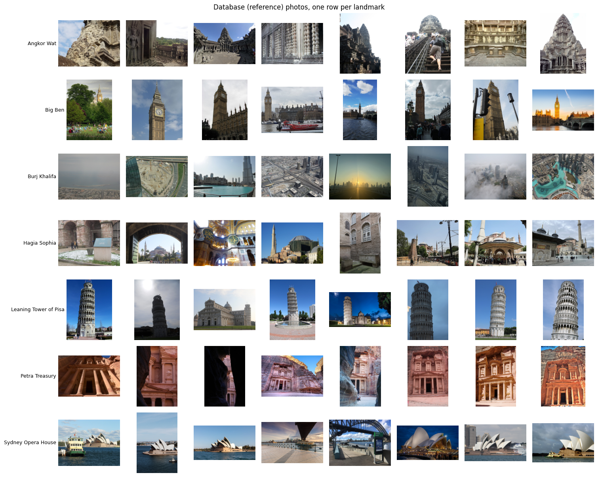

*Figure 1. The 56 reference photos, one row per landmark.*

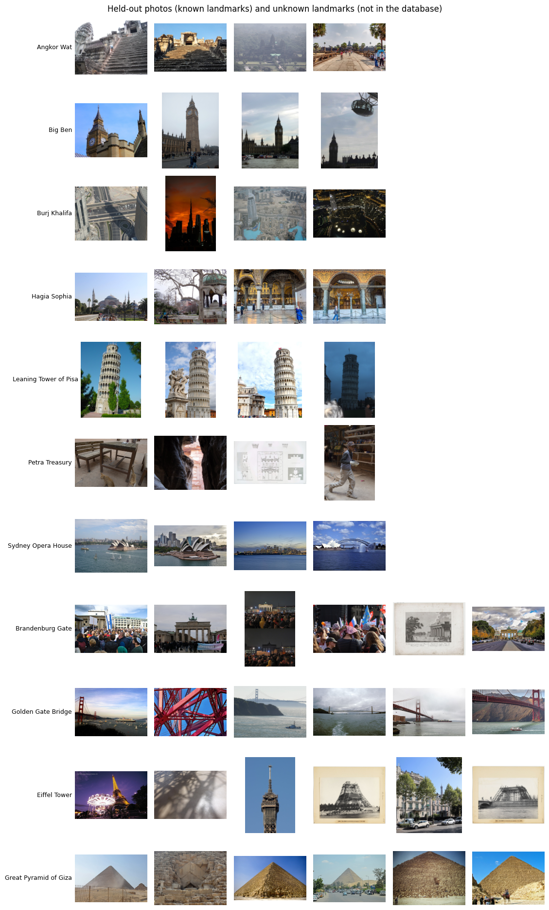

*Figure 2. The 28 held-out photos (first seven rows, 4 each) and the 24 photos of unknown places (last four rows, 6 each).*

Looking at the two contact sheets shows that the photos are not a clean benchmark:

- **Burj Khalifa:** many reference photos are views taken *from* the tower (city, roads and the fountain seen from above, haze) rather than photos of the tower.
- **Hagia Sophia:** the references include an interior view and surroundings such as a fountain and courtyards.
- **Petra Treasury:** none of the four held-out photos shows the Treasury facade. They show a table with chairs, a dark rock passage, a line drawing or plan, and a person walking.
- **Angkor Wat:** the held-out photos show a staircase, a hazy distant view and a road, while the references include close-up carvings and corridors.
- **Eiffel Tower (unknown test place):** several photos are old photographs of the tower under construction, and one is a night photo of a carousel.

A query that does not show the landmark cannot be recognised from reference photos, and a reference photo that does not show it adds noise. How much this lowers the scores was not measured.

### 2.4 Licences

All 108 photos carry a free licence. Most require attribution, so [`landmark_data/credits.csv`](landmark_data/credits.csv) must stay with the photos.

| Licence | Photos |
| :--- | ---: |
| CC BY-SA 4.0 | 38 |
| CC BY 2.0 | 23 |
| CC BY-SA 3.0 | 12 |
| CC0 | 11 |
| CC BY 3.0 | 9 |
| CC BY 4.0 | 6 |
| CC BY-SA 2.0 | 5 |
| Public domain | 4 |

*Table 1. Licences of the 108 photos.*

## 3. Task 2: SIFT Feature Extraction

### 3.1 How SIFT builds a keypoint

1. **Find spots at every size.** The photo is blurred more and more and neighbouring blur levels are subtracted (Difference of Gaussians). A keypoint is a pixel that is the largest or smallest among its 26 neighbours across space and scale. This makes SIFT scale invariant.
2. **Keep only good ones.** Spots with weak contrast and spots on straight edges are dropped (`contrastThreshold`, `edgeThreshold`).
3. **Give each keypoint a direction.** A 36-bin histogram of gradient directions around the keypoint gives its own "up". Everything is described relative to it, which makes SIFT rotation invariant.
4. **Describe the neighbourhood.** The rotated square around the keypoint is split into 4 x 4 cells with 8 direction bins each: 4 x 4 x 8 = **128 numbers**, normalised so that brightness and contrast changes matter little.

### 3.2 Settings and results

OpenCV `SIFT_create` was used with `nfeatures=1500`, `nOctaveLayers=3`, `contrastThreshold=0.04`, `edgeThreshold=10` and `sigma=1.6`. Every photo is first shrunk so that its longer side is at most 800 px and converted to grayscale. Descriptors and keypoints of all 108 photos are stored with their landmark labels.

| Group | Photos | Keypoints, min | median | max | SIFT time (ms, mean) |
| :--- | ---: | ---: | ---: | ---: | ---: |
| database | 56 | 218 | 1500 | 1502 | 158.8 |
| held-out | 28 | 399 | 1500 | 1501 | 159.6 |
| unknown (calibration) | 12 | 737 | 1500 | 1501 | 141.9 |
| unknown (test) | 12 | 271 | 1500 | 1502 | 165.1 |

*Table 2. Keypoints per photo. OpenCV can return slightly more than `nfeatures` (a keypoint with two strong directions appears twice).*

The median is 1,500 in every group, so the cap is reached by at least half of the photos. The cap therefore decides how many keypoints most photos have; Section 9 returns to this.

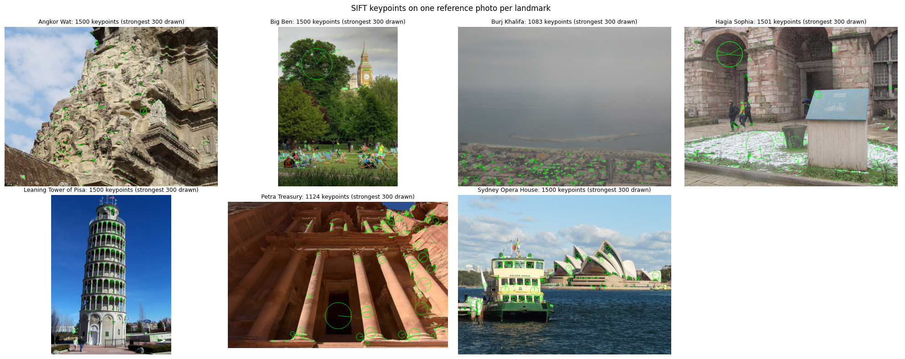

*Figure 3. The first reference photo of each landmark with its strongest 300 keypoints (circle size is the keypoint scale, the line is its direction). The Burj Khalifa photo has 1,083 keypoints and the Petra Treasury photo 1,124. The first Big Ben photo shows the tower small in the background, and most of its keypoints sit on the park.*

### 3.3 Three small demos of what SIFT does inside

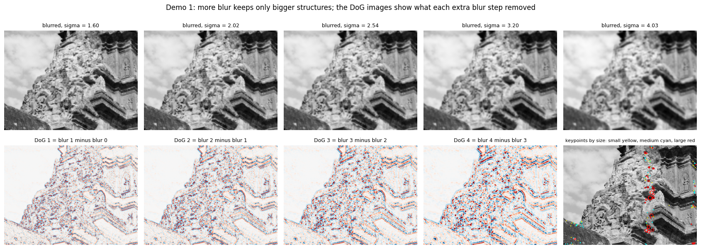

*Figure 4. Demo 1 (one octave, simplified). More blur keeps only larger structures; each Difference-of-Gaussians image shows the detail that one extra blur step removed. The last panel colours the keypoints by size.*

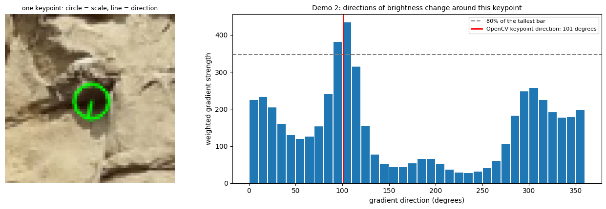

*Figure 5. Demo 2. The directions of brightness change around one keypoint. The tallest bar lines up with the direction OpenCV reports (101 degrees). For the 195 strongest keypoints of the demo photo, OpenCV's direction is within 15 degrees of a strong peak of this simplified histogram in 155 cases (79%).*

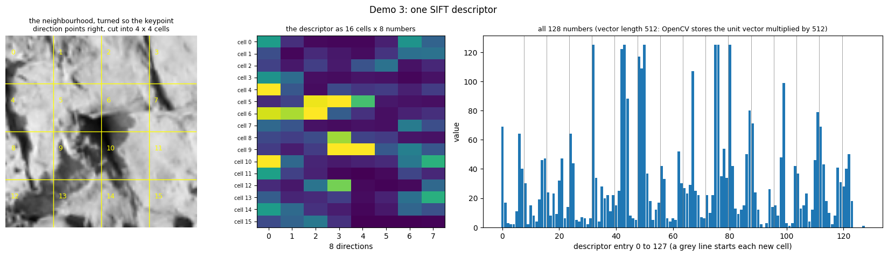

*Figure 6. Demo 3. One descriptor: the neighbourhood cut into 4 x 4 cells (left), the 16 x 8 table of numbers (middle) and all 128 values (right). OpenCV stores the unit vector multiplied by 512, so a descriptor has length 512.*

## 4. Task 3: Query Image Processing

A query photo goes through exactly the same steps as a reference photo: load, resize to at most 800 px, grayscale, SIFT keypoints, descriptors. Nothing else is done, because descriptors are only comparable if they are made the same way.

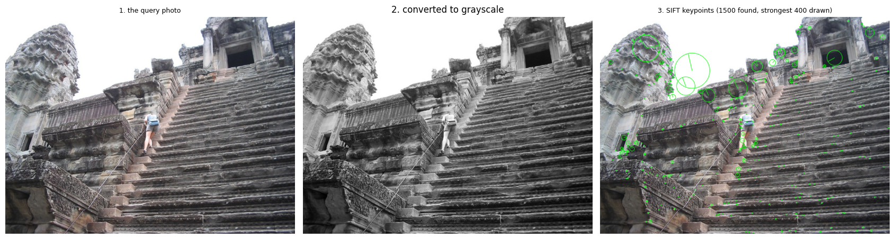

*Figure 7. The first held-out Angkor Wat photo: original, grayscale, and its keypoints (strongest 400 drawn). It is 800 x 600 pixels after resizing and has 1,500 keypoints; SIFT took 179 ms.*

## 5. Task 4: Feature Matching and Landmark Recognition

### 5.1 Matching

For every query descriptor the brute-force matcher measures the Euclidean distance to **every** descriptor of one reference photo and returns the two closest (k = 2). **Lowe's ratio test** keeps a match only if the closest distance is below 0.75 times the second closest: a clear winner is trusted, a near tie is a coin flip and is discarded. Each reference photo is matched separately and gets its own count of reliable matches, because pooling the photos of one landmark would make a correct match look ambiguous (the same spot appears in two photos). A landmark's score is the count of its best reference photo, and the landmarks are ranked by that score.

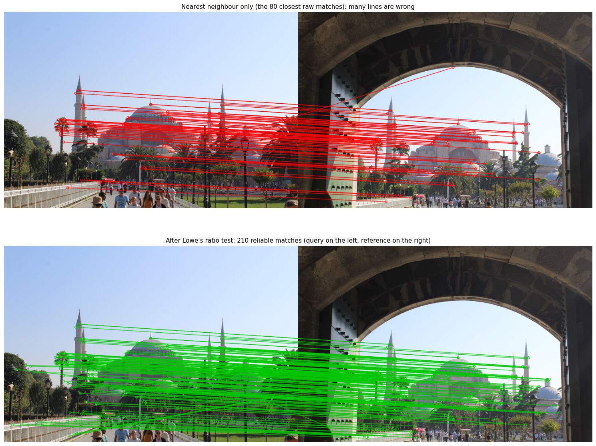

*Figure 8. The clearest held-out/reference pair (a Hagia Sophia query on the left, the reference on the right). Top: the 80 closest raw matches, mostly right with a few stray lines. Of the 1,500 raw matches only 210 survive the ratio test (bottom), and 1,290 are thrown away. The two photos show the same scene from almost the same position, so this is an easy pair.*

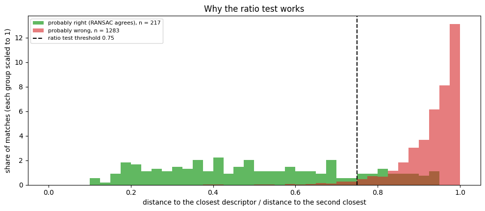

*Figure 9. Why the ratio test works. Matches that RANSAC later accepts ("probably right", n = 217) have low ratios; the others ("probably wrong", n = 1,283) pile up near 1. The threshold 0.75 keeps 81% of the probably-right matches and 3% of the probably-wrong ones. RANSAC is only a stand-in for the unknown truth.*

| Rank | Landmark | Best reference photo | Reliable matches |
| ---: | :--- | :--- | ---: |
| 1 | **Hagia Sophia** | hagia_sophia_02.jpg | **210** |
| 2 | Burj Khalifa | burj_khalifa_08.jpg | 32 |
| 3 | Big Ben | big_ben_02.jpg | 31 |
| 4 | Leaning Tower of Pisa | leaning_tower_of_pisa_06.jpg | 27 |
| 5 | Petra Treasury | petra_treasury_01.jpg | 25 |
| 6 | Angkor Wat | angkor_wat_02.jpg | 23 |
| 7 | Sydney Opera House | sydney_opera_house_07.jpg | 23 |

*Table 3. Ranking of the landmarks for that query (reliable matches of the best reference photo). The six wrong landmarks collect 23 to 32 reliable matches by chance.*

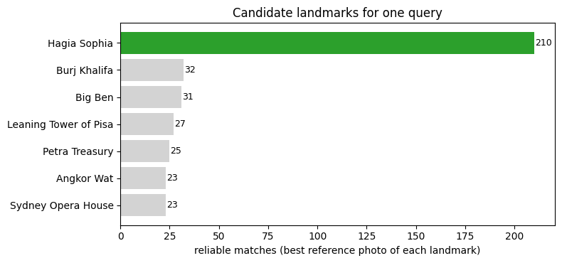

*Figure 10. The same ranking as a chart. Matching this one query against the 56 reference photos took 3.0 s.*

### 5.2 The decision rule

The brief warns against classifying by the largest match count alone, and the notebook follows that. The pipeline for one query is: SIFT on the query, match against every reference photo, rank the landmarks, run RANSAC on the best reference photo of the **top 3 landmarks**, take the landmark with the most inliers, then apply three checks. The landmark is accepted only if all three pass:

1. at least `t_good` reliable matches after the ratio test,
2. at least `t_inliers` RANSAC inliers,
3. at least `margin` times the inliers of the runner-up landmark.

### 5.3 Choosing the thresholds (calibration)

The thresholds are measured, not guessed. All 7 x 8 x 4 = 224 combinations of `t_good` in {8, 10, 12, 15, 20, 25, 30}, `t_inliers` in {6, 8, 10, 12, 15, 20, 25, 30} and `margin` in {1.0, 1.25, 1.5, 2.0} were tried on the calibration set. 196 combinations accept none of the 12 unknown photos and name a wrong landmark for at most 2% of the known photos. Among them, 12 recognise the most known photos (23.2%, 13 of 56), and the one in the middle of that group was taken:

| Threshold | Value |
|---|---:|
| `t_good` (reliable matches) | 12 |
| `t_inliers` (RANSAC inliers) | 6 |
| `margin` (best against runner-up) | 1.5 |

On the calibration data this rule recognises 23.2% of the known photos, names no wrong landmark and accepts none of the unknown photos. The common rule of thumb "at least 10 inliers, nothing else" gives 21.4% recognised, no wrong name and no unknown accepted.

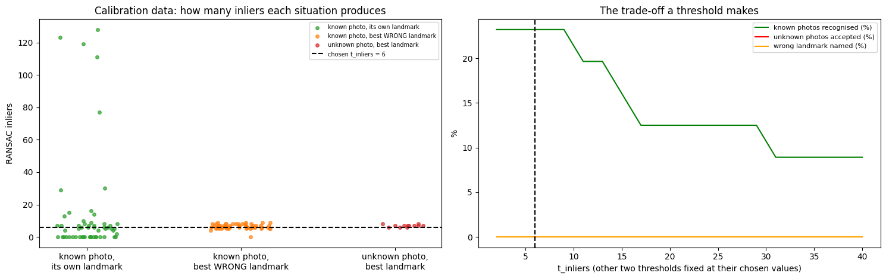

*Figure 11. Left: inliers for known photos with their own landmark (green), for the best wrong landmark (orange) and for unknown photos (red). Right: what the inlier threshold costs.*

Figure 11 shows why the result is weak. For most known photos the correct landmark collects almost nothing (0 to 10 inliers; 0 means it was not among the three candidates that were checked, or had fewer than 8 reliable matches); only a handful reach more than 70. The best wrong landmark and the best landmark for an unknown photo both sit at about 4 to 9 inliers, so the chosen line at 6 lies **inside the noise band**. The unknown photos are kept out mainly by the margin check, not by the inlier count. Raising `t_inliers` cannot reduce wrong answers (already 0%) and quickly loses known photos: 23.2% are recognised at 6, 12.5% from 17 to 29, and 8.9% above 30.

### 5.4 Test results

The test uses only photos that took no part in choosing the thresholds.

| Test photos | Result |
|---|---|
| 28 held-out photos of known landmarks | 5 recognised correctly (17.9%), 0 wrong landmark, 23 wrongly rejected |
| 12 photos of unknown places | 11 correctly rejected (91.7%), 1 wrongly accepted |
| All 40 | 16 decisions correct (40.0%) |

| Landmark | Held-out photos | Recognised | Wrong name | Rejected | Median inliers |
| :--- | ---: | ---: | ---: | ---: | ---: |
| Angkor Wat | 4 | 0 | 0 | 4 | 6 |
| Big Ben | 4 | 1 | 0 | 3 | 9 |
| Burj Khalifa | 4 | 0 | 0 | 4 | 6 |
| Hagia Sophia | 4 | 1 | 0 | 3 | 5 |
| Leaning Tower of Pisa | 4 | 2 | 0 | 2 | 11 |
| Petra Treasury | 4 | 1 | 0 | 3 | 7 |
| Sydney Opera House | 4 | 0 | 0 | 4 | 6 |

*Table 4. Held-out photos per landmark. "Median inliers" is the median RANSAC inliers of the best candidate.*

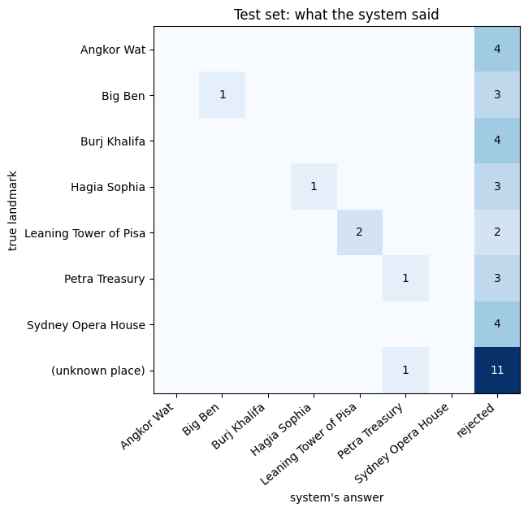

*Figure 12. What the system said (columns) for each true landmark (rows). The single unknown photo that was accepted was named Petra Treasury.*

### 5.5 Why not "largest count wins"?

Three decision rules were applied to the same test photos:

| Decision rule | Known photos recognised (%) | Wrong landmark named (%) | Known photos rejected (%) | Unknown photos accepted (%) |
| :--- | ---: | ---: | ---: | ---: |
| A: largest match count wins | 42.9 | 57.1 | 0.0 | 100.0 |
| B: reliable matches >= 84 | 3.6 | 3.6 | 92.9 | 0.0 |
| C: our rule (matches + RANSAC + margin) | 17.9 | **0.0** | 82.1 | 8.3 |

*Table 5. Rule A names the landmark with the most reliable matches and never rejects. Rule B adds a calibrated threshold on that count (at least 84 reliable matches). Rule C is the rule of Section 5.2.*

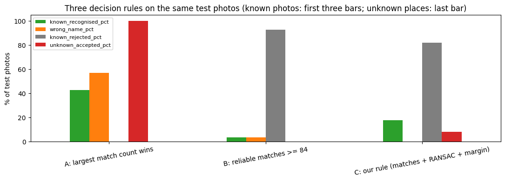

*Figure 13. The same three rules as bars (known photos: first three bars; unknown places: last bar).*

Rule A recognises more known photos than rule C (42.9% against 17.9%) but names the wrong landmark for 57.1% of them and accepts every unknown photo. Rule C trades recall for safety: it never names a wrong landmark on the known test photos, and it accepted 1 of 12 unknown photos. A count threshold alone (rule B) was too strict at the level that keeps unknown photos out.

## 6. Task 5: Landmark Localization

**RANSAC** finds the common geometric story in a set of matches that contains wrong ones. It repeats: pick 4 random matches (the minimum that fixes a homography), compute the 3 x 3 homography `H`, count how many other matches land within 5 pixels of their partner after projection (the inliers), and keep the best `H`. A homography describes how a flat surface moves between two photos; a building is 3D, so one `H` fits well only for moderate viewpoint changes or distant buildings.

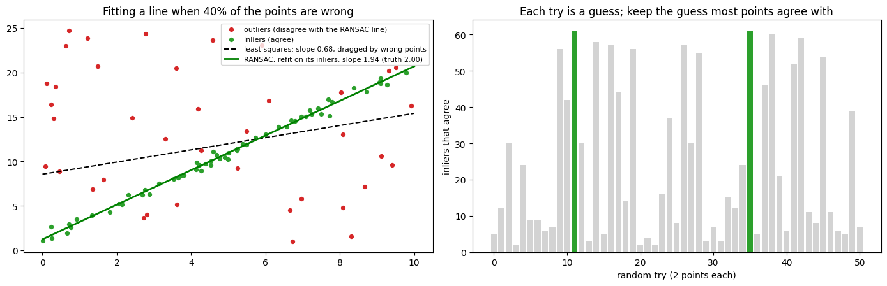

*Figure 14. A toy version with a line instead of a homography: 40% of the 100 points are wrong. Least squares gives a slope of 0.68, RANSAC (refit on its inliers) gives 1.94, the truth is 2.00. The best of 51 random guesses had 61 of the 100 points agreeing.*

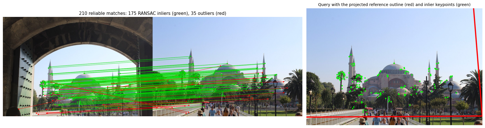

*Figure 15. The clearest pair. Left: 210 reliable matches, 175 RANSAC inliers (green, 83%) and 35 outliers (red), reference on the left and query on the right. Right: the query with the four projected corners of the reference photo (red outline) and the inlier keypoints (green).*

For this pair the projected corners in the query are (-50, -48), (757, -36), (799, 491) and (-90, 496), and the outline passes all four checks. Because the reference shows the same scene from almost the same position, the outline almost coincides with the photo border. The outline is the footprint of the whole **reference photo** inside the query, so in general it includes sky and surroundings and not only the building.

The polygon is drawn only if it passes four plain-sense checks: it is convex, its area is between 0.5% and 25 times the query area, its longest side is at most 20 times its shortest, and its corner angles lie between 20 and 160 degrees. Otherwise the application prints why (for example "the outline is twisted (not convex)") and draws nothing.

## 7. Task 6: Performance Evaluation

### 7.1 The six conditions

Each condition is run for every known landmark (one photo per condition), plus the unknown places:

| Condition | How the query is made |
|---|---|
| Original | the first held-out photo of the landmark, unchanged |
| Rotated | the same photo rotated by 45 degrees (black corners) |
| Resized | the same photo at 50% size |
| Reduced brightness | the same photo at 40% brightness |
| Different viewpoint | the other held-out photo of that landmark that shares the fewest reliable matches with the original (a proxy for a larger viewpoint change) |
| Unknown landmark | the first photo of each unknown test place (Eiffel Tower, Great Pyramid of Giza) |

| Condition | Tests | Correct | Mean inliers | Mean time (s) |
| :--- | ---: | ---: | ---: | ---: |
| original | 7 | 1 | 31.29 | 3.08 |
| rotated 45 deg | 7 | 1 | 31.00 | 3.44 |
| resized 50% | 7 | 1 | 18.43 | 1.83 |
| brightness x0.4 | 7 | 2 | 19.57 | 1.76 |
| different viewpoint | 7 | 2 | 16.43 | 2.92 |
| unknown landmark | 2 | 2 | 8.00 | 4.10 |

*Table 6. Task 6 summary. "Correct" means the right landmark was named, or an unknown place was rejected.*

<details>
<summary>Full Task 6 table (predicted landmark, keypoints, reliable matches, decision, time for every test)</summary>

| True landmark | Condition | Query photo | System answer | Keypoints | Reliable matches | RANSAC inliers | Decision | Correct | Time (s) |
| :--- | :--- | :--- | :--- | ---: | ---: | ---: | :--- | :--- | ---: |
| Angkor Wat | original | angkor_wat_09.jpg | rejected | 1500 | 53 | 7 | REJECTED | no | 3.26 |
| Angkor Wat | rotated 45 deg | angkor_wat_09.jpg | rejected | 1500 | 49 | 7 | REJECTED | no | 3.35 |
| Angkor Wat | resized 50% | angkor_wat_09.jpg | Burj Khalifa | 1500 | 44 | 9 | RECOGNIZED | no | 3.09 |
| Angkor Wat | brightness x0.4 | angkor_wat_09.jpg | rejected | 1275 | 42 | 7 | REJECTED | no | 2.82 |
| Angkor Wat | different viewpoint | angkor_wat_11.jpg | rejected | 705 | 27 | 6 | REJECTED | no | 1.61 |
| Big Ben | original | big_ben_09.jpg | rejected | 1500 | 47 | 10 | REJECTED | no | 3.18 |
| Big Ben | rotated 45 deg | big_ben_09.jpg | rejected | 1500 | 47 | 10 | REJECTED | no | 3.30 |
| Big Ben | resized 50% | big_ben_09.jpg | rejected | 623 | 19 | 5 | REJECTED | no | 1.35 |
| Big Ben | brightness x0.4 | big_ben_09.jpg | rejected | 814 | 34 | 8 | REJECTED | no | 1.78 |
| Big Ben | different viewpoint | big_ben_11.jpg | rejected | 1383 | 52 | 7 | REJECTED | no | 2.98 |
| Burj Khalifa | original | burj_khalifa_09.jpg | rejected | 1500 | 40 | 6 | REJECTED | no | 3.17 |
| Burj Khalifa | rotated 45 deg | burj_khalifa_09.jpg | rejected | 1500 | 71 | 6 | REJECTED | no | 3.46 |
| Burj Khalifa | resized 50% | burj_khalifa_09.jpg | rejected | 1014 | 29 | 5 | REJECTED | no | 2.19 |
| Burj Khalifa | brightness x0.4 | burj_khalifa_09.jpg | rejected | 1088 | 39 | 7 | REJECTED | no | 2.41 |
| Burj Khalifa | different viewpoint | burj_khalifa_12.jpg | rejected | 1500 | 37 | 6 | REJECTED | no | 3.22 |
| Hagia Sophia | original | hagia_sophia_09.jpg | Hagia Sophia | 1500 | 210 | 175 | RECOGNIZED | yes | 3.08 |
| Hagia Sophia | rotated 45 deg | hagia_sophia_09.jpg | Hagia Sophia | 1500 | 222 | 172 | RECOGNIZED | yes | 3.31 |
| Hagia Sophia | resized 50% | hagia_sophia_09.jpg | Hagia Sophia | 609 | 106 | 92 | RECOGNIZED | yes | 1.24 |
| Hagia Sophia | brightness x0.4 | hagia_sophia_09.jpg | Hagia Sophia | 684 | 107 | 93 | RECOGNIZED | yes | 1.53 |
| Hagia Sophia | different viewpoint | hagia_sophia_12.jpg | rejected | 1500 | 21 | 6 | REJECTED | no | 3.12 |
| Leaning Tower of Pisa | original | leaning_tower_of_pisa_09.jpg | rejected | 1500 | 42 | 7 | REJECTED | no | 3.12 |
| Leaning Tower of Pisa | rotated 45 deg | leaning_tower_of_pisa_09.jpg | rejected | 1500 | 44 | 8 | REJECTED | no | 3.30 |
| Leaning Tower of Pisa | resized 50% | leaning_tower_of_pisa_09.jpg | rejected | 1154 | 32 | 7 | REJECTED | no | 2.71 |
| Leaning Tower of Pisa | brightness x0.4 | leaning_tower_of_pisa_09.jpg | rejected | 1119 | 32 | 8 | REJECTED | no | 2.47 |
| Leaning Tower of Pisa | different viewpoint | leaning_tower_of_pisa_11.jpg | Leaning Tower of Pisa | 1500 | 56 | 15 | RECOGNIZED | yes | 3.24 |
| Petra Treasury | original | petra_treasury_09.jpg | rejected | 1194 | 87 | 8 | REJECTED | no | 2.62 |
| Petra Treasury | rotated 45 deg | petra_treasury_09.jpg | rejected | 1500 | 211 | 8 | REJECTED | no | 3.59 |
| Petra Treasury | resized 50% | petra_treasury_09.jpg | rejected | 429 | 33 | 6 | REJECTED | no | 1.01 |
| Petra Treasury | brightness x0.4 | petra_treasury_09.jpg | rejected | 217 | 16 | 6 | REJECTED | no | 0.55 |
| Petra Treasury | different viewpoint | petra_treasury_10.jpg | Petra Treasury | 1500 | 81 | 66 | RECOGNIZED | yes | 3.14 |
| Sydney Opera House | original | sydney_opera_house_09.jpg | rejected | 1500 | 25 | 6 | REJECTED | no | 3.15 |
| Sydney Opera House | rotated 45 deg | sydney_opera_house_09.jpg | rejected | 1501 | 105 | 6 | REJECTED | no | 3.79 |
| Sydney Opera House | resized 50% | sydney_opera_house_09.jpg | rejected | 363 | 9 | 5 | REJECTED | no | 1.22 |
| Sydney Opera House | brightness x0.4 | sydney_opera_house_09.jpg | Sydney Opera House | 345 | 13 | 8 | RECOGNIZED | yes | 0.77 |
| Sydney Opera House | different viewpoint | sydney_opera_house_10.jpg | rejected | 1500 | 48 | 9 | REJECTED | no | 3.11 |
| Eiffel Tower (not in database) | unknown landmark | eiffel_tower_01.jpg | rejected | 1500 | 28 | 8 | REJECTED | yes | 3.21 |
| Great Pyramid of Giza (not in database) | unknown landmark | great_pyramid_of_giza_01.jpg | rejected | 1500 | 45 | 8 | REJECTED | yes | 4.98 |

*Table 7. All 37 tests. Reliable matches and inliers are those of the best candidate. Time is SIFT + matching + RANSAC for one query.*

</details>

In the original, rotated and resized conditions only **Hagia Sophia** is recognised correctly: its held-out photo `hagia_sophia_09.jpg` has a reference photo from almost the same position. It keeps high inlier counts under every change (175 original, 172 rotated, 92 at half size, 93 at brightness x0.4) and is recognised each time. This is the clearest evidence that SIFT's rotation, scale and illumination handling works. Apart from the Pisa and Petra viewpoint photos, every other result is at the noise level (5 to 10 inliers). Three results need care:

- Sydney Opera House at brightness x0.4 is recognised with 8 inliers, while the unchanged photo was rejected with 6. This is borderline and likely a chance acceptance.
- **Angkor Wat resized to 50% is recognised as Burj Khalifa** (9 inliers): a wrong acceptance caused by a threshold that sits at the noise level.
- Leaning Tower of Pisa (15 inliers) and Petra Treasury (66 inliers) are recognised only for the "different viewpoint" photo, not for the original photo of that landmark.

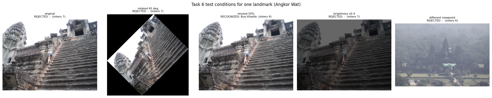

*Figure 16. The five query versions for Angkor Wat. Only the resized photo is accepted, and with the wrong name.*

### 7.2 Sweeps over rotation, scale and brightness

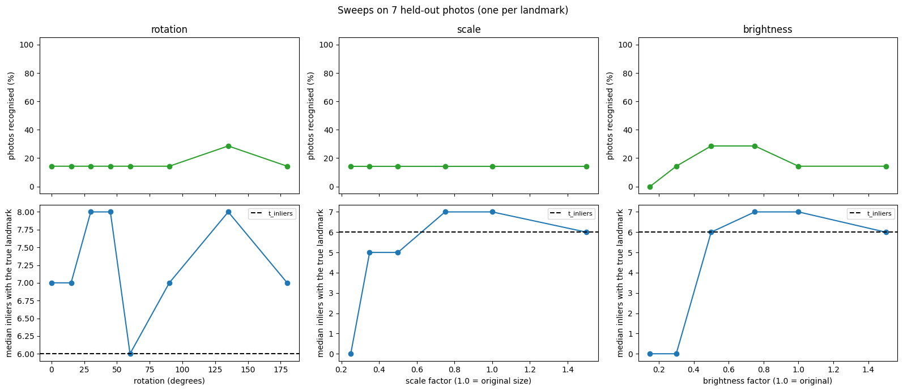

*Figure 17. Sweeps over rotation (0 to 180 degrees), scale (0.25 to 1.5) and brightness (0.15 to 1.5) on the first held-out photo of each landmark.*

The sweeps say little about SIFT's invariance, because only one of the seven base photos is recognised at the starting point. The recognised share sits at 1 of 7 (14%) at almost every setting and the median inliers stay at the noise level (about 5 to 8). When most base photos already fail at the start, rotating or resizing cannot make them fail further. A cleaner invariance test would match each photo against its own transformed copy; this was not done. The exact values are in `results/sweep_results.csv`.

### 7.3 Processing time

| Stage | Mean (ms) | Median (ms) |
| :--- | ---: | ---: |
| SIFT on the query | 161.3 | 165.0 |
| Brute-force matching against 56 reference photos | 2627.2 | 2868.3 |
| RANSAC on the top 3 candidates | 92.3 | 81.7 |
| **Total** | **2880.8** | **3136.1** |

*Table 8. Time per query over the 40 test photos on the Colab runtime.*

Brute-force matching is 91% of the total (2,627 of 2,881 ms). Its cost grows in proportion to the number of reference photos:

| Reference photos in the database | Matching time per query (s) |
| ---: | ---: |
| 7 | 0.36 |
| 14 | 0.7 |
| 28 | 1.43 |
| 56 | 2.9 |

*Table 9. Matching time for five test queries against a database of 7, 14, 28 and 56 reference photos (about 52 ms per reference photo).*

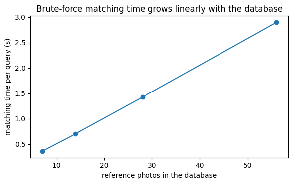

*Figure 18. Brute-force matching time against database size.*

### 7.4 Failure analysis

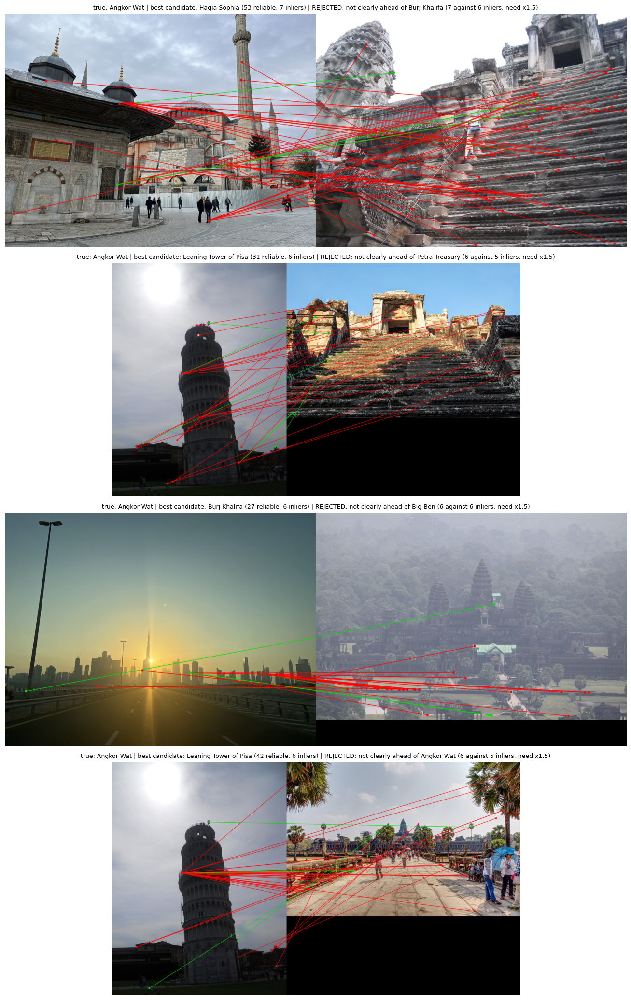

*Figure 19. The first four errors in file order, all Angkor Wat photos (24 test photos went wrong in total: 23 known photos rejected and 1 unknown photo accepted). Reference on the left, query on the right; green = geometrically consistent, red = not.*

In each case the best candidate is an unrelated landmark (Hagia Sophia, Leaning Tower of Pisa, Burj Khalifa), almost every match line is red, and the 6 to 7 "inliers" are the noise floor of this setup: a likely explanation is that the best of up to 2,000 random homographies fits a handful of accidental matches within 5 pixels (this explanation was not tested). The decision rule rejects all four because the winner is not 1.5 times ahead of the runner-up.

## 8. Application Output

`recognize_landmark(photo)` is the application of the notebook. For one photo it prints a result block and draws a figure with the seven things the brief asks for: the query photo, its SIFT keypoints, the matched features with the best candidate, the predicted landmark name, the number of reliable matches, the localized region (only when geometric verification succeeds) and a message saying recognised or rejected.

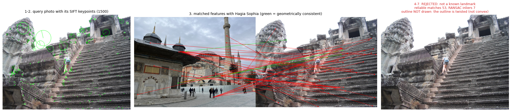

*Figure 20. A held-out Angkor Wat photo. It is rejected: the best candidate has 7 inliers against 6 for the runner-up.*

```
LANDMARK RECOGNITION RESULT
Query photo: /content/lab06_data/queries/known/Angkor Wat/angkor_wat_09.jpg
Keypoints found in the query: 1500
Most likely landmark: Hagia Sophia (best reference photo: hagia_sophia_08.jpg)
Reliable matches (ratio test): 53
RANSAC inliers: 7 (13% of the reliable matches)
Runner-up: Burj Khalifa with 6 inliers
Localization: outline NOT drawn: the outline is twisted (not convex)
Decision: REJECTED (not clearly ahead of Burj Khalifa (7 against 6 inliers, need x1.5))
Processing time: 3.29 s (SIFT 0.30, matching 2.83, RANSAC 0.17)
```

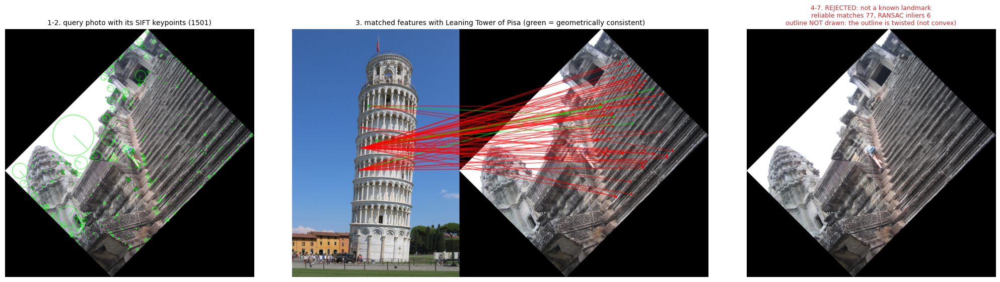

*Figure 21. The same photo rotated by 45 degrees.*

```
LANDMARK RECOGNITION RESULT
Query photo: (image array)
Keypoints found in the query: 1501
Most likely landmark: Leaning Tower of Pisa (best reference photo: leaning_tower_of_pisa_07.jpg)
Reliable matches (ratio test): 77
RANSAC inliers: 6 (8% of the reliable matches)
Runner-up: Burj Khalifa with 6 inliers
Localization: outline NOT drawn: the outline is twisted (not convex)
Decision: REJECTED (not clearly ahead of Burj Khalifa (6 against 6 inliers, need x1.5))
Processing time: 3.42 s (SIFT 0.28, matching 2.83, RANSAC 0.31)
```

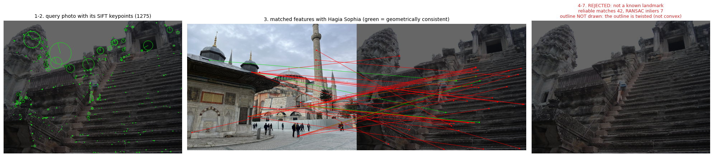

*Figure 22. The same photo at 40% brightness.*

```
LANDMARK RECOGNITION RESULT
Query photo: (image array)
Keypoints found in the query: 1275
Most likely landmark: Hagia Sophia (best reference photo: hagia_sophia_08.jpg)
Reliable matches (ratio test): 42
RANSAC inliers: 7 (17% of the reliable matches)
Runner-up: Burj Khalifa with 6 inliers
Localization: outline NOT drawn: the outline is twisted (not convex)
Decision: REJECTED (not clearly ahead of Burj Khalifa (7 against 6 inliers, need x1.5))
Processing time: 2.91 s (SIFT 0.19, matching 2.55, RANSAC 0.16)
```

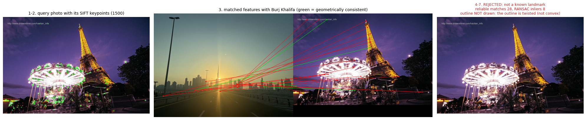

*Figure 23. A photo of the Eiffel Tower, which is not in the database. It is rejected, as intended.*

```
LANDMARK RECOGNITION RESULT
Query photo: /content/lab06_data/queries/unknown_test/Eiffel Tower/eiffel_tower_01.jpg
Keypoints found in the query: 1500
Most likely landmark: Burj Khalifa (best reference photo: burj_khalifa_05.jpg)
Reliable matches (ratio test): 28
RANSAC inliers: 8 (29% of the reliable matches)
Runner-up: Hagia Sophia with 7 inliers
Localization: outline NOT drawn: the outline is twisted (not convex)
Decision: REJECTED (not clearly ahead of Hagia Sophia (8 against 7 inliers, need x1.5))
Processing time: 3.14 s (SIFT 0.20, matching 2.90, RANSAC 0.03)
```

The photo used for these demonstrations is not recognised even before it is rotated or darkened, so all four results are rejections. A successful recognition with a drawn outline is shown in Figure 15 (Hagia Sophia, 175 inliers). The app described in the Bonus section produces screenshots of successful cases as well.

## 9. Discussion

**What worked.**
- SIFT finds and describes about 1,500 keypoints per photo in 0.16 s.
- The ratio test removes most wrong matches: in the clearest pair only 210 of 1,500 raw matches survive, and the threshold keeps 81% of the matches RANSAC accepts and 3% of the rest (Figure 9).
- RANSAC separates a true match from a chance match: the clearest pair has 175 inliers among 210 reliable matches, while chance candidates collect 4 to 9 (Figure 11).
- When a reference photo shows the scene from a similar position, SIFT's invariances hold: the Hagia Sophia photo keeps 172 inliers rotated by 45 degrees, 92 at half size and 93 at brightness x0.4.
- The decision rule is conservative: 0 wrong landmark names on the 28 known test photos, 11 of 12 unknown places rejected.

**What did not work.** Recognition of new photos is poor: 5 of 28 (17.9%) on the test photos and 13 of 56 (23.2%) in calibration. Most known photos get no more inliers with their own landmark than a wrong landmark gets by chance (Figure 11), the threshold of 6 inliers sits inside that noise band, and the rule produced one wrong acceptance in Task 6 (Angkor Wat as Burj Khalifa) and one unknown photo accepted in the test (named Petra Treasury).

**Why, as far as the evidence goes.**
- *Photos without a matching reference view.* The successes are the cases where a reference photo shows the scene from almost the same position (the Hagia Sophia pair, Figure 8). In Task 6 the rejected photos have between 9 and 211 reliable matches but only 5 to 10 inliers, which means the matches do not agree geometrically (for example Petra Treasury rotated: 211 reliable matches, 8 inliers; Figure 19 shows four cases).
- *Photos that do not show the landmark.* Several held-out and reference photos are not photos of the landmark's exterior (Section 2.3). These can never be matched correctly. The size of this effect was not measured.
- *Hypotheses that were not tested:* a single homography fits only one plane of a 3D building, so photos from different sides may share few geometrically consistent matches; the cap of 1,500 keypoints and the 800 px working size limit the detail that can match (the median photo reaches the cap); 8 reference photos per landmark cover few viewpoints.

**What would be worth trying (none of it was tested).** Remove photos that do not show the landmark and re-run; use more reference photos per landmark; raise the keypoint cap and the working size (matching cost grows quickly with both, because brute force compares every descriptor pair); try a looser RANSAC threshold or a geometric model that suits 3D scenes; combine evidence from several reference photos of the same landmark; calibrate on more unknown photos. For a database much larger than 56 photos, an approximate nearest-neighbour index would replace brute force.

## 10. Limitations

1. **Small test set.** 28 known photos (4 per landmark) and 12 unknown photos; one photo is 3.6 points of the known-photo rate. The measured rates carry wide uncertainty.
2. **Uncleaned photos.** Some photos do not show the landmark (Section 2.3), and the effect was not measured.
3. **Thresholds at the noise level.** The chosen `t_inliers` of 6 lies inside the band of chance inliers. Rejection of unknown photos depends on the margin check, and the rule is fragile: it accepted one unknown photo and, in Task 6, one resized photo under the wrong name.
4. **Calibration on 12 unknown photos.** Two unknown places are a small sample of "everything else".
5. **Sweeps are uninformative.** They start from base photos that are mostly not recognised (Section 7.2).
6. **"Different viewpoint" is a proxy.** It is the held-out photo with the fewest shared matches, not a measured camera angle.
7. **One run, one random photo selection.** No repeated selections or confidence intervals were computed.
8. **Brute force does not scale.** About 52 ms per reference photo per query (Table 9); the brief asks for a brute-force matcher, so no faster index was used.
9. **Single dataset source.** All photos come from Wikimedia Commons and reflect what Commons contributors photograph.
10. **Descriptor cap.** At most 1,500 keypoints per photo and a working size of 800 px were used throughout; other settings were not compared.

## 11. Conclusion

SIFT keypoints, brute-force matching with Lowe's ratio test and a RANSAC homography work as intended on this data when a reference photo shows the scene from a similar position: the clearest Hagia Sophia photo keeps 172, 92 and 93 inliers when rotated by 45 degrees, halved in size or darkened to 40%. As a landmark recogniser built from 8 uncleaned reference photos per landmark, however, the system recognises only 5 of 28 new photos (17.9%), because for most known photos the correct landmark collects no more RANSAC inliers than a wrong one collects by chance (0 to 10 against about 4 to 9). A decision rule that never names a wrong landmark on the test photos has to reject most of them, and its threshold at 6 inliers sits inside the noise band. The most useful next step is to remove photos that do not show the landmark and add more reference views, then repeat the calibration and test; the notebook is set up to re-run in one pass.

---

## Bonus: Tourism Information App

The notebook's application is also available as a small web app in [`app/`](app/): a visitor uploads a photo and sees the seven items of Section 8, the top three candidates with their reliable matches and inliers, the reason for every rejection, and the processing time. The app reuses the exact pipeline and the thresholds of the notebook (12 reliable matches, 6 inliers, margin 1.5) and tells the user, in plain words, how limited the recognition is (5 of 28 new photos recognised in the lab test).

Quick start, from the `lab 6` folder:

```bash
python -m venv .venv
source .venv/bin/activate            # Windows: .venv\Scripts\activate
pip install -r app/requirements.txt

python app/app.py                                   # web app at http://127.0.0.1:7860
python app/recognize_cli.py "path/to/photo.jpg"     # prints LANDMARK RECOGNITION RESULT
python app/tools/make_screenshots.py                # writes assets/app_*.png from sample photos
pytest app/tests -q                                 # parity tests against the notebook's results
```

Usage details, measured speed and screenshots are in [`app/README.md`](app/README.md).

---

## Appendix A: Lab Task Coverage

| Brief task | Where | Evidence |
|---|---|---|
| 1. Landmark image database (at least 5 landmarks, several photos each, one folder per landmark) | Section 2 | 7 landmarks x 12 photos, Figures 1 and 2, Table 1 |
| 2. SIFT feature extraction (grayscale, keypoints, descriptors, display, store with labels) | Section 3 | Table 2, Figures 3 to 6 |
| 3. Query image processing (load, grayscale, keypoints, descriptors, display) | Section 4 | Figure 7 |
| 4. Matching: brute force, Euclidean, k = 2, ratio test, count, rank, threshold, not the largest count alone | Section 5 | Figures 8 to 13, Tables 3 to 5 |
| 5. Localization: homography with RANSAC, project corners, polygon, show matches and inliers, message if unreliable | Section 6 | Figures 14 and 15 |
| 6. Performance evaluation: six conditions, table of results | Section 7 | Tables 6 to 9, Figures 16 to 19 |
| Expected output: the seven items on screen | Section 8 | Figures 20 to 23 and the app |
| Deliverables: source code, database, screenshots, results table, discussion | the notebook, `landmark_data/`, Section 8, Table 7, Sections 9 and 10 | |

## Appendix B: Repository Contents

```
lab assignment 2 - task 6/
├── README.md
├── SIFT_Landmark_Recognition_Lab06_executed.ipynb   executed notebook (outputs included)
├── assets/                                          figures used in this README (and app screenshots)
├── landmark_data/
│   ├── database/<landmark>/                         56 reference photos
│   ├── queries/known/<landmark>/                    28 held-out photos
│   ├── queries/unknown_calibration/<place>/         12 photos
│   ├── queries/unknown_test/<place>/                12 photos
│   ├── credits.csv                                  author and licence of every photo
│   └── db_signature.txt
├── results/
│   ├── landmark_config.json                         SIFT settings, ratio, RANSAC settings, thresholds
│   ├── results_summary.json
│   ├── test_results.csv                             decision for every test photo
│   ├── task6_results.csv                            the Task 6 table
│   ├── sweep_results.csv                            rotation, scale and brightness sweeps
│   ├── query_results.json                           per-query numbers (matches, inliers, outlines, times)
│   └── extras.json                                  thresholds and calibration summary
└── app/                                             tourism information app (see Bonus)
```

## Appendix C: How to Reproduce

1. Open the notebook in Google Colab. Any runtime works; nothing uses the GPU.
2. Run all cells and allow the Google Drive prompt. The photos are downloaded from Wikimedia Commons (this takes several minutes) and kept in `MyDrive/Lab06_SIFT_Landmarks/landmark_data`.
3. Results, features and figures are saved to `MyDrive/Lab06_SIFT_Landmarks/run_<id>/`, where `<id>` is a hash of the notebook's CONFIG (`9fb91e8d` for this run).
4. If Colab disconnects, run all cells again. Finished work is loaded from Drive and skipped; the log of this run shows it was resumed once (96 saved query results were loaded at the start).

All random choices use seed 42. A re-download selects photos from the live Commons categories, which can change over time, so the notebook keeps the first selection on Drive and reuses it.

## Appendix D: Credits and Licences

All 108 photos are from Wikimedia Commons; their authors and licences are listed in [`landmark_data/credits.csv`](landmark_data/credits.csv) and summarised in Table 1. Keep that file with the photos when you copy or share them, and follow the terms of each licence (for example attribution, and share-alike for the CC BY-SA photos).

## Appendix E: References

1. Lowe, D. G. (2004). Distinctive image features from scale-invariant keypoints. *International Journal of Computer Vision*, 60(2), 91-110.
2. Fischler, M. A. and Bolles, R. C. (1981). Random sample consensus: a paradigm for model fitting with applications to image analysis and automated cartography. *Communications of the ACM*, 24(6), 381-395.
3. Hartley, R. and Zisserman, A. (2004). *Multiple View Geometry in Computer Vision* (2nd ed.). Cambridge University Press.
4. OpenCV documentation: `cv::SIFT`, `cv::BFMatcher`, `cv::findHomography`.
5. Wikimedia Commons, https://commons.wikimedia.org/ (source of all photos).
