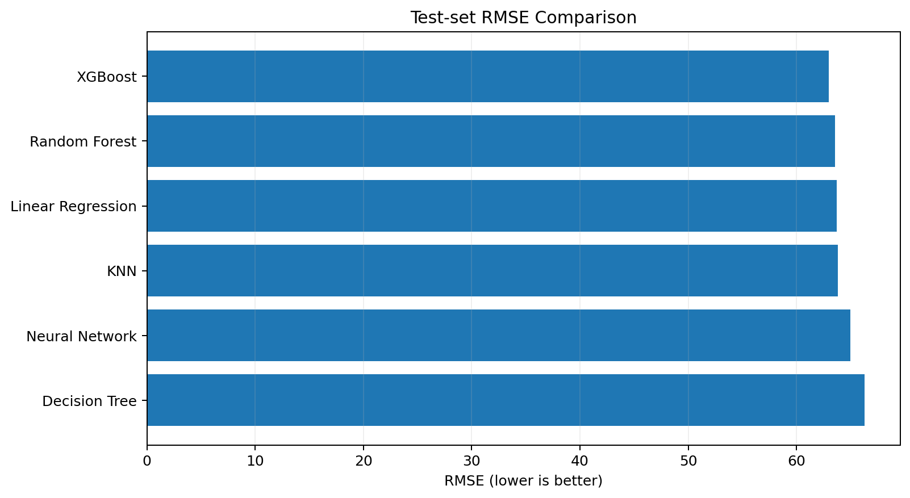

# Lab Assignment 3 (Task 10) — Comparing Six Regression Algorithms

**Author** Adeel Asghar

## Objective

Compare six regression algorithms on the same held-out split of the scikit-learn Diabetes dataset. The task uses scaled BMI (`bmi_x1000`) to predict a quantitative measure of disease progression one year after baseline. The dataset contains 442 records. The `patient_id` column is used only to identify rows.

## Methodology

1. Split the dataset into 353 training records and 89 test records using an 80:20 split with random seed 42.
2. Train Linear Regression, Decision Tree, Random Forest, a multilayer perceptron (MLP), XGBoost, and k-nearest neighbors (KNN) using fixed hyperparameters.
3. Fit the standard scaler inside the KNN and MLP pipelines using the training data.
4. Evaluate every model on the same test records using mean absolute error (MAE), mean squared error (MSE), root mean squared error (RMSE), and R². Rank models by test RMSE.

## Results

| Model | MAE | MSE | RMSE | R² |
| --- | ---: | ---: | ---: | ---: |
| XGBoost | 51.03 | 3965.54 | 62.97 | 0.2515 |
| Random Forest | 50.92 | 4038.04 | 63.55 | 0.2378 |
| Linear Regression | 52.26 | 4061.83 | 63.73 | 0.2334 |
| KNN | 50.65 | 4070.47 | 63.80 | 0.2317 |
| Neural Network (MLP) | 52.13 | 4218.15 | 64.95 | 0.2038 |
| Decision Tree | 53.78 | 4391.21 | 66.27 | 0.1712 |

XGBoost achieved the lowest RMSE and highest R² on this split. KNN had the lowest MAE. These results describe one fixed split and one predictor, so the rankings may change with different splits, features, or hyperparameters. [Full metrics CSV](six_regression_metrics.csv)



[Actual versus predicted values for all six models](assets/actual_vs_predicted_six_models.png)

## Run the notebook

From this lab folder, install the dependencies and open the notebook in Jupyter.

```shell
python -m pip install jupyter numpy pandas matplotlib scikit-learn xgboost
jupyter notebook Six_Regression_Algorithms_Executed.ipynb
```

Run the cells from top to bottom. The notebook reads the supplied CSV from the working directory and reconstructs it from scikit-learn if it is missing. Running all cells rewrites the metrics CSV and the two plots.

## Files

| File | Contents |
| --- | --- |
| [Six_Regression_Algorithms_Executed.ipynb](Six_Regression_Algorithms_Executed.ipynb) | Executed notebook with data preparation, model training, evaluation, and interpretation |
| [diabetes_regression_dataset.csv](diabetes_regression_dataset.csv) | 442 records with patient ID, scaled BMI, and disease progression |
| [six_regression_metrics.csv](six_regression_metrics.csv) | Test metrics for all six models |
| [assets/](assets/) | Actual-versus-predicted scatterplots and the RMSE comparison chart |
