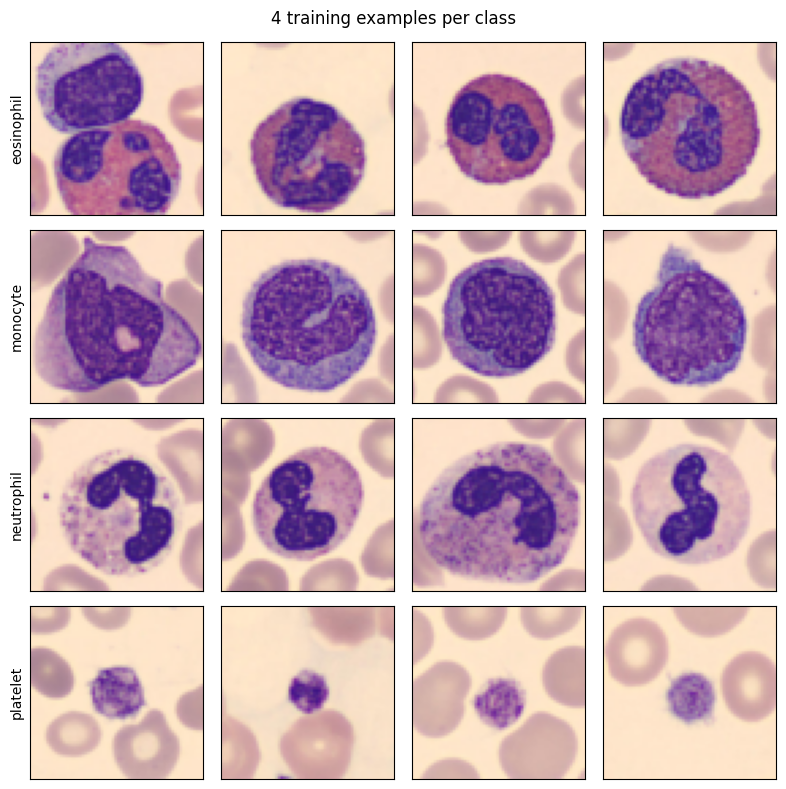
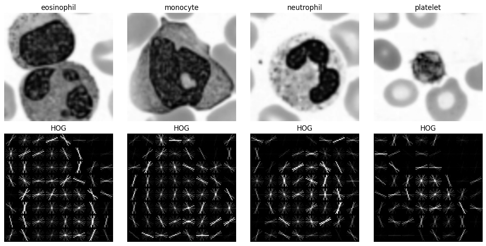
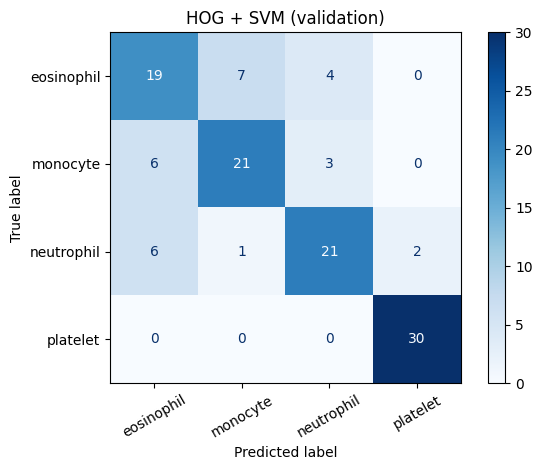
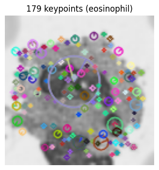
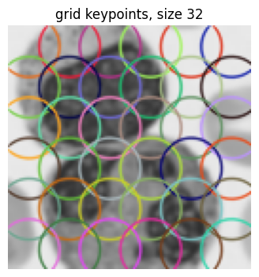
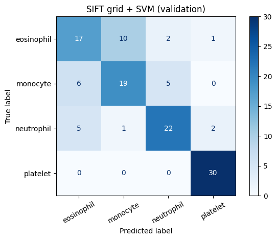
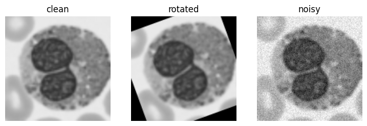

# Lab Mid Exam: HOG vs SIFT on Blood-Cell Images
**Registration:** FA23-BAI-047 | Computer Vision Lab

Sections: Setup, Q1 Data, Q2 HOG + SVM, Q3 SIFT + SVM, Q4 Robustness, Q5 Short answers and AI log.

## Personal settings
The settings are computed from the registration number, so the rule is visible in the code.


```
!pip -q install medmnist
REG = "FA23-BAI-047"
last_digit = int(REG[-1])
SEED = int(REG[-2:])                       # last two digits
HOG_CELL = 8 if last_digit % 2 == 0 else 16  # even -> 8, odd -> 16
GRID = 4 if last_digit <= 4 else 6           # 0-4 -> 4x4 grid, 5-9 -> 6x6 grid
print(f"Registration {REG}: seed={SEED}, HOG cell={HOG_CELL}x{HOG_CELL}, SIFT grid={GRID}x{GRID} ({GRID*GRID} keypoints)")
```

    Registration FA23-BAI-047: seed=47, HOG cell=16x16, SIFT grid=6x6 (36 keypoints)


## Q4 prediction (written BEFORE any model was trained or tested)
**Rotation (20 degrees):** I think **HOG** will lose more accuracy. HOG builds histograms of gradient directions inside fixed cells, so a rotated cell changes both which pixels fall in each cell and the direction of every gradient, and nothing in the method corrects for that.

**Noise (sigma = 0.05):** I think **HOG** will lose more accuracy. HOG uses the raw pixel gradients, and noise adds many small random gradients. SIFT first blurs the image with a Gaussian, which removes much of the noise before gradients are measured.

*(These are predictions, not results. Q4 checks them against the table.)*


```
import numpy as np, cv2, matplotlib.pyplot as plt
from skimage.feature import hog
from skimage import exposure
from sklearn.svm import LinearSVC
from sklearn.preprocessing import StandardScaler
from sklearn.pipeline import make_pipeline
from sklearn.metrics import accuracy_score, f1_score, confusion_matrix, ConfusionMatrixDisplay
import pandas as pd
np.random.seed(SEED)
```

## Q1. Data setup


```
from medmnist import BloodMNIST
CLASS_IDS = {1: "eosinophil", 5: "monocyte", 6: "neutrophil", 7: "platelet"}   # original BloodMNIST label -> name
NAMES = list(CLASS_IDS.values())
N_PER = {"train": 100, "val": 30, "test": 30}
rng = np.random.default_rng(SEED)            # every random choice below uses my seed

def load_subset(split, n):
    ds = BloodMNIST(split=split, download=True, size=64)
    X, y = ds.imgs, ds.labels.ravel()
    Xs, ys = [], []
    for new_label, orig in enumerate(CLASS_IDS):          # new labels 0..3
        idx = np.where(y == orig)[0]
        pick = rng.choice(idx, n, replace=False)          # n images of this class, chosen with the seed
        Xs.append(X[pick]); ys += [new_label] * n
    return np.concatenate(Xs), np.array(ys)

data = {s: load_subset(s, n) for s, n in N_PER.items()}
for s, (X, y) in data.items():
    print(f"{s:5s} images {X.shape}  labels {y.shape}  class counts {dict(zip(NAMES, map(int, np.bincount(y))))}")
```

    100%|██████████| 156M/156M [02:22<00:00, 1.09MB/s]


    train images (400, 64, 64, 3)  labels (400,)  class counts {'eosinophil': 100, 'monocyte': 100, 'neutrophil': 100, 'platelet': 100}
    val   images (120, 64, 64, 3)  labels (120,)  class counts {'eosinophil': 30, 'monocyte': 30, 'neutrophil': 30, 'platelet': 30}
    test  images (120, 64, 64, 3)  labels (120,)  class counts {'eosinophil': 30, 'monocyte': 30, 'neutrophil': 30, 'platelet': 30}


```
# one grid: 4 example images per class
Xtr_rgb, ytr = data["train"]
fig, axes = plt.subplots(4, 4, figsize=(8, 8))
for r in range(4):
    idx = np.where(ytr == r)[0][:4]
    for c, i in enumerate(idx):
        axes[r, c].imshow(Xtr_rgb[i]); axes[r, c].set_xticks([]); axes[r, c].set_yticks([])
    axes[r, 0].set_ylabel(NAMES[r], fontsize=10)
plt.suptitle("4 training examples per class"); plt.tight_layout(); plt.show()
```


    

    


```
# image preparation: grayscale, resize to 128 x 128
def prep(imgs):
    return np.stack([cv2.resize(cv2.cvtColor(i, cv2.COLOR_RGB2GRAY), (128, 128), interpolation=cv2.INTER_LINEAR) for i in imgs])
Xtr, Xva, Xte = prep(data["train"][0]), prep(data["val"][0]), prep(data["test"][0])
ytr, yva, yte = data["train"][1], data["val"][1], data["test"][1]
print("prepared shapes:", Xtr.shape, Xva.shape, Xte.shape, "dtype", Xtr.dtype)
```

    prepared shapes: (400, 128, 128) (120, 128, 128) (120, 128, 128) dtype uint8


```
# shared helpers for training and reporting
def fit_choose_C(Ftr, ytr, Fva, yva):
    best = None
    for C in [0.1, 1, 10]:
        m = make_pipeline(StandardScaler(), LinearSVC(C=C, max_iter=20000, random_state=SEED)).fit(Ftr, ytr)
        acc = accuracy_score(yva, m.predict(Fva))
        print(f"  C={C:<4} validation accuracy = {acc:.4f}")
        if best is None or acc > best[0]:        # strict '>' keeps the smaller C when two tie
            best = (acc, C, m)
    print(f"  chosen C = {best[1]}")
    return best[2], best[1]

def report(model, F, y, title):
    pred = model.predict(F)
    acc, f1 = accuracy_score(y, pred), f1_score(y, pred, average="macro")
    cm = confusion_matrix(y, pred)
    print(f"{title}: accuracy = {acc:.4f}, macro-F1 = {f1:.4f}")
    print(pd.DataFrame(cm, index=[f"true {n}" for n in NAMES], columns=[f"pred {n}" for n in NAMES]))
    ConfusionMatrixDisplay(cm, display_labels=NAMES).plot(cmap="Blues", xticks_rotation=30)
    plt.title(title); plt.tight_layout(); plt.show()
    return acc, f1, cm
```

## Q2. HOG + SVM


```
def hog_feat(img, visualize=False):
    return hog(img, orientations=9, pixels_per_cell=(HOG_CELL, HOG_CELL), cells_per_block=(2, 2),
               block_norm="L2-Hys", visualize=visualize)
Htr = np.array([hog_feat(i) for i in Xtr]); Hva = np.array([hog_feat(i) for i in Xva])
print("HOG feature length (from code):", Htr.shape[1])
```

    HOG feature length (from code): 1764


**Hand calculation of the HOG feature length** (image 128 x 128, cell 16 x 16, 9 orientations, blocks of 2 x 2 cells, block stride 1 cell):

- Cells per side = 128 / 16 = 8, so there are 8 x 8 = 64 cells.
- Blocks per side = 8 - 2 + 1 = 7, so there are 7 x 7 = 49 blocks.
- Values per block = 2 x 2 cells x 9 orientations = 36.
- Feature length = 49 x 36 = **1764**.

The next cell checks that the code gives the same number.


```
cells = 128 // HOG_CELL; blocks = cells - 2 + 1
expected = blocks * blocks * 2 * 2 * 9
print(f"cells/side={cells}, blocks/side={blocks}, expected length={expected}, code length={Htr.shape[1]}")
assert expected == Htr.shape[1]
```

    cells/side=8, blocks/side=7, expected length=1764, code length=1764


```
# HOG picture for one image from each class
fig, axes = plt.subplots(2, 4, figsize=(12, 6))
for c in range(4):
    img = Xtr[np.where(ytr == c)[0][0]]
    _, himg = hog_feat(img, visualize=True)
    axes[0, c].imshow(img, cmap="gray"); axes[0, c].set_title(NAMES[c]); axes[0, c].axis("off")
    axes[1, c].imshow(exposure.rescale_intensity(himg, in_range=(0, 10)), cmap="gray"); axes[1, c].set_title("HOG"); axes[1, c].axis("off")
plt.tight_layout(); plt.show()
```


    

    


```
print("Training HOG + SVM:")
hog_model, hog_C = fit_choose_C(Htr, ytr, Hva, yva)
hog_val = report(hog_model, Hva, yva, "HOG + SVM (validation)")
```

    Training HOG + SVM:
      C=0.1  validation accuracy = 0.7583
      C=1    validation accuracy = 0.7583
      C=10   validation accuracy = 0.7583
      chosen C = 0.1
    HOG + SVM (validation): accuracy = 0.7583, macro-F1 = 0.7567
                     pred eosinophil  pred monocyte  pred neutrophil  \
    true eosinophil               19              7                4   
    true monocyte                  6             21                3   
    true neutrophil                6              1               21   
    true platelet                  0              0                0   
    
                     pred platelet  
    true eosinophil              0  
    true monocyte                0  
    true neutrophil              2  
    true platelet               30  


    

    


## Q3. SIFT + SVM


```
sift = cv2.SIFT_create()
counts, kp_lists = [], []
for img in Xtr:
    kps, _ = sift.detectAndCompute(img, None)
    counts.append(len(kps)); kp_lists.append(kps)
counts = np.array(counts)
print(f"Keypoints per training image: average = {counts.mean():.2f}, min = {counts.min()}, max = {counts.max()}")
print("Images with zero keypoints:", int((counts == 0).sum()), "of", len(counts))
i = int(np.argmax(counts))
vis = cv2.drawKeypoints(Xtr[i], kp_lists[i], None, flags=cv2.DRAW_MATCHES_FLAGS_DRAW_RICH_KEYPOINTS)
plt.figure(figsize=(4, 4)); plt.imshow(vis); plt.axis("off"); plt.title(f"{counts[i]} keypoints ({NAMES[ytr[i]]})"); plt.show()
```

    Keypoints per training image: average = 71.08, min = 7, max = 179
    Images with zero keypoints: 0 of 400


    

    


**Why a different number of keypoints per image is a problem for an SVM:** an SVM needs every image to be one vector of the same length, but normal SIFT gives a different number of 128-number descriptors for each image, so the descriptors cannot be stacked into one fixed-size feature vector.


```
# fixed grid of keypoints, keypoint size 32
step = 128 / GRID
grid_kps = [cv2.KeyPoint(float((c + 0.5) * step), float((r + 0.5) * step), 32) for r in range(GRID) for c in range(GRID)]
print("grid points:", len(grid_kps), "| first points:", [(round(k.pt[0], 1), round(k.pt[1], 1)) for k in grid_kps[:3]])

def sift_grid_feat(img):
    kps, desc = sift.compute(img, [cv2.KeyPoint(k.pt[0], k.pt[1], k.size) for k in grid_kps])
    assert desc.shape == (GRID * GRID, 128), desc.shape      # every grid point must give a descriptor
    return desc.reshape(-1)                                   # join all descriptors into one vector
Str = np.array([sift_grid_feat(i) for i in Xtr]); Sva = np.array([sift_grid_feat(i) for i in Xva])
print("SIFT feature length (from code):", Str.shape[1])
```

    grid points: 36 | first points: [(10.7, 10.7), (32.0, 10.7), (53.3, 10.7)]
    SIFT feature length (from code): 4608


**Hand calculation of the SIFT feature length:** the grid is 6 x 6 = 36 points, and every point gives one descriptor of 128 numbers, so the length is 36 x 128 = **4608**.


```
assert Str.shape[1] == GRID * GRID * 128
print(f"{GRID*GRID} x 128 = {GRID*GRID*128}  (matches the code)")
# draw the grid keypoints on one image
vis = cv2.drawKeypoints(Xtr[0], grid_kps, None, flags=cv2.DRAW_MATCHES_FLAGS_DRAW_RICH_KEYPOINTS)
plt.figure(figsize=(4, 4)); plt.imshow(vis); plt.axis("off"); plt.title("grid keypoints, size 32"); plt.show()
```

    36 x 128 = 4608  (matches the code)


    

    


```
print("Training SIFT (grid) + SVM:")
sift_model, sift_C = fit_choose_C(Str, ytr, Sva, yva)
sift_val = report(sift_model, Sva, yva, "SIFT grid + SVM (validation)")
```

    Training SIFT (grid) + SVM:
      C=0.1  validation accuracy = 0.7333
      C=1    validation accuracy = 0.7333
      C=10   validation accuracy = 0.7333
      chosen C = 0.1
    SIFT grid + SVM (validation): accuracy = 0.7333, macro-F1 = 0.7294
                     pred eosinophil  pred monocyte  pred neutrophil  \
    true eosinophil               17             10                2   
    true monocyte                  6             19                5   
    true neutrophil                5              1               22   
    true platelet                  0              0                0   
    
                     pred platelet  
    true eosinophil              1  
    true monocyte                0  
    true neutrophil              2  
    true platelet               30  


    

    


## Q4. Robustness (test set; the test set is used only here)


```
# the same change is applied to the grayscale 128x128 test images before feature extraction
def rotate20(imgs):
    M = cv2.getRotationMatrix2D((64, 64), 20, 1.0)
    return np.stack([cv2.warpAffine(i, M, (128, 128), flags=cv2.INTER_LINEAR, borderMode=cv2.BORDER_CONSTANT, borderValue=0) for i in imgs])
def add_noise(imgs, sigma=0.05):
    r = np.random.default_rng(SEED)
    x = imgs.astype(np.float32) / 255.0                        # scale to 0..1
    x = np.clip(x + r.normal(0, sigma, x.shape), 0, 1)
    return (x * 255).round().astype(np.uint8)
variants = {"clean": Xte, "rotated": rotate20(Xte), "noisy": add_noise(Xte)}
fig, axes = plt.subplots(1, 3, figsize=(9, 3))
for ax, (k, v) in zip(axes, variants.items()):
    ax.imshow(v[0], cmap="gray", vmin=0, vmax=255); ax.set_title(k); ax.axis("off")
plt.show()

rows = []
for name, model, fn in (("HOG + SVM", hog_model, hog_feat), ("SIFT + SVM", sift_model, sift_grid_feat)):
    row = {"Model": name}
    for k, imgs in variants.items():
        F = np.array([fn(i) for i in imgs])
        row[f"{k.capitalize()} accuracy"] = accuracy_score(yte, model.predict(F))   # models are frozen: only predict
    rows.append(row)
table = pd.DataFrame(rows).set_index("Model")
print(table.round(4))
```


    

    


                Clean accuracy  Rotated accuracy  Noisy accuracy
    Model                                                       
    HOG + SVM           0.7500            0.6083            0.25
    SIFT + SVM          0.7583            0.4917            0.75


```
# numbers for the written explanation (all taken from the table above)
drop = pd.DataFrame({"rotation drop": table["Clean accuracy"] - table["Rotated accuracy"],
                     "noise drop": table["Clean accuracy"] - table["Noisy accuracy"]})
print(drop.round(4))
worst_rot, worst_noise = drop["rotation drop"].idxmax(), drop["noise drop"].idxmax()
print("Model losing more under rotation:", worst_rot, "| under noise:", worst_noise)
print("Prediction (HOG loses more in both):", "CORRECT for rotation" if worst_rot.startswith("HOG") else "WRONG for rotation",
      "and", "CORRECT for noise" if worst_noise.startswith("HOG") else "WRONG for noise")
```

                rotation drop  noise drop
    Model                                
    HOG + SVM          0.1417      0.5000
    SIFT + SVM         0.2667      0.0083
    Model losing more under rotation: SIFT + SVM | under noise: HOG + SVM
    Prediction (HOG loses more in both): WRONG for rotation and CORRECT for noise


**Was my prediction correct? (three sentences, using the table above)**

My prediction was only half correct. Under noise it was correct: HOG fell from 0.7500 to 0.2500 (a drop of 0.5000, which equals chance for four balanced classes) while SIFT fell from 0.7583 to 0.7500 (a drop of 0.0083), probably because SIFT smooths the image with a Gaussian before measuring gradients, while HOG uses raw gradients that noise corrupts. Under rotation it was wrong: SIFT lost more (0.7583 to 0.4917, a drop of 0.2667) than HOG (0.7500 to 0.6083, a drop of 0.1417), so the fixed-grid SIFT descriptors were less robust to a 20 degree rotation than HOG; a possible reason is that the grid keypoints are given no orientation, so the descriptors are not rotated with the image (I did not test this).

## Q5. Short answers and AI log

**(a) Why does HOG use block normalisation?** Gradient strength changes with local lighting and contrast, so the same shape could give very different histogram values in a bright and in a dark image. HOG groups cells into overlapping blocks and normalises the values inside each block, so a change in brightness or contrast affects all values of the block in a similar way and is mostly removed.

**(b) Why is it wrong to choose C using the test set?** The test set must stand in for new, unseen images. If C is picked because it scores best on the test set, the model has been tuned to that data, so the test accuracy is too optimistic and no longer an honest estimate. C must be chosen on the validation set, and the test set used once at the end.


```
# which two classes were confused most (from the validation confusion matrices of Q2 and Q3)
def most_confused(cm):
    best = (0, None)
    for a in range(4):
        for b in range(a + 1, 4):
            n = cm[a, b] + cm[b, a]
            if n > best[0]: best = (n, (a, b))
    return best
for name, res in (("HOG + SVM", hog_val), ("SIFT + SVM", sift_val)):
    n, pair = most_confused(res[2])
    print(f"{name}: most confused pair = {NAMES[pair[0]]} and {NAMES[pair[1]]} ({n} mistakes between them)" if pair else f"{name}: no confusion")
```

    HOG + SVM: most confused pair = eosinophil and monocyte (13 mistakes between them)
    SIFT + SVM: most confused pair = eosinophil and monocyte (16 mistakes between them)


**Most confused classes and why grayscale may make it harder:** the two classes confused most were **eosinophil and monocyte**, for both models: 13 mistakes between them for HOG (7 eosinophils predicted as monocyte, 6 monocytes as eosinophil) and 16 for SIFT (10 and 6), while platelet was classified correctly in all 30 images by both models. Eosinophils are mainly recognised by their bright red-orange granules, and monocytes by their bluish-grey cytoplasm and kidney-shaped nucleus, so grayscale removes the colour information that separates them and leaves similar rounded grey cells with a textured nucleus.

**AI log** *
| Prompt (one line) | What I changed | How I checked the result |
|---|---|---|
| "Build the HOG and SIFT notebook for the lab mid exam PDF" | Replaced the settings by my own (seed, cell size, grid); rewrote the explanations in my own words | Printed shapes and class counts; asserted the HOG length (1764) and SIFT length (4608) against my hand calculation; looked at the example grid, HOG pictures and grid keypoints |

